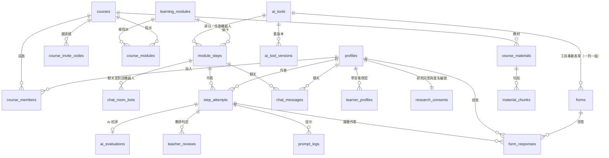

# 資料字典（Data Dictionary）

> 需求說明書 DAT-003（P0）：交付每個欄位的名稱、意義、格式、缺失值、計算方式、版本及資料表關係。
> 對應程式：`backend/api/export.py`（匯出）、`supabase/schema.sql` 與 `supabase/migrations/`（資料表）。
> 2026-11-24 建立；**新增或修改匯出欄位時，同一個 PR 必須更新這份文件**（`tests/test_data_dictionary.py` 會檢查每個匯出欄位都有寫在這裡）。

---

## 1. 匯出檔案總覽

| 項目 | 研究用（去識別化） | 教學用（可識別） |
|---|---|---|
| API | `POST /api/export/research` | `POST /api/export/teaching` |
| 誰可以匯出 | 只限教授（owner） | 只限教授（owner） |
| 包含哪些學生 | 這門課的學生（active，以及已被移出者先前的作答），**且研究同意 `is_consented = true`、未撤回** | 這門課的學生（active，以及已被移出者先前的作答） |
| 識別欄位 | `research_id`（匿名研究編號） | `student_name`、`student_email` |
| 作答原文 `answer_text` | 選填；**符合個資規則的片段換成 `[已遮罩]`** | 選填；原文 |
| 用途 | 研究分析、發表 | 教學管理；**不可用於研究發表** |
| 稽核 | 每次匯出寫一筆 `export_logs` | 同左 |

**共同規格**

- 三種資料集（請求的 `dataset`）：
  - `attempts`（預設）：一列 = **一次作答**（`step_attempts` 一筆）。聊天室關卡是「送出評分」那一次，作答內容是當時整理的整段對話。欄位見 2.1～2.5
  - `chat_messages`：一列 = **一則聊天室訊息**（`chat_messages` 一筆），學生與機器人的訊息都有。欄位見 2.1、2.6
  - `form_responses`：一列 = **一份表單填答裡的一題**（`form_responses` 一筆展開；略過的表單只有一列）。欄位見 2.1、2.7
- 兩種格式（請求的 `format`）：
  - `csv`（預設）：一次一個資料集。UTF-8、開頭有 BOM（Excel 直接開中文不亂碼）；逗號分隔，含逗號或換行的欄位以雙引號包住（RFC 4180）
  - `xlsx`：一個 Excel 檔三個工作表「作答」「聊天訊息」「表單填答」，欄位名稱與 CSV 相同
- 排序：依學生、再依作答時間（舊 → 新）。
- 篩選條件（請求 body）：`course_id`（必填）、`module_id`、`date_from`、`date_to`（以作答時間的 UTC 日期比較，含首尾）、`include_content`。
- 只匯出「指派給這門課的模組」裡的作答；老師與助理自己的試作不匯出。
- 回應標頭 `X-Export-Row-Count` = 資料列數（CSV 是選的資料集；xlsx 是「作答」）；`X-Export-Chat-Count` = 聊天訊息列數；`X-Export-Form-Count` = 表單填答列數。

> ⚠️ 研究同意書流程（PRI-004）尚未上線：在此之前所有學生的 `is_consented` 都是 false，研究用匯出會是空的（只有欄位名稱）。

---

## 2. 欄位定義

缺失值一律輸出為**空白**（CSV 空字串）。時間一律為 **UTC**，ISO 8601 格式（例如 `2026-11-24T07:21:00.123456+00:00`），換算台灣時間要加 8 小時。

### 2.1 識別欄位

| 欄位 | 出現在 | 意義 | 格式 | 缺失值 | 來源 |
|---|---|---|---|---|---|
| `research_id` | 研究用 | 匿名研究編號；同一位學生在所有匯出裡都相同 | 文字，`SPED-` + 8 碼英數（例：`SPED-3f2a9c1e`） | 不會缺（沒有編號的學生不匯出） | `research_consents.anonymous_research_id`（註冊時由觸發器自動產生） |
| `student_name` | 教學用 | 學生姓名 | 文字 | 學生沒填時空白 | `profiles.full_name` |
| `student_email` | 教學用 | 學生 Email | 文字 | — | `profiles.email` |

### 2.2 作答與關卡

| 欄位 | 意義 | 格式 | 缺失值 | 計算方式／來源 |
|---|---|---|---|---|
| `module_title` | 模組名稱 | 文字 | — | `learning_modules.title` |
| `step_order` | 關卡在模組裡的順序 | 整數，從 1 開始 | — | `module_steps.step_order`（老師調整順序後會改變，請以 `step_title` 輔助辨識） |
| `step_title` | 關卡名稱 | 文字 | — | `module_steps.step_title` |
| `tool_title` | 這一關使用的機器人；聊天室關卡是「評分機器人」 | 文字 | — | `ai_tools.title`（目前的名稱，不是作答當時的名稱） |
| `attempt_number` | 這位學生在這一關的第幾次作答 | 整數，從 1 開始 | — | `step_attempts.attempt_number` |
| `submitted_at` | 送出作答的時間 | UTC，ISO 8601 | — | `step_attempts.created_at` |
| `status` | 這次作答的結果 | `submitted` 已送出等待中（例如等老師複核）／`passed` 通過／`revision_required` 需要修改 | — | `step_attempts.status`；依關卡「怎麼算通過」決定（`module_steps.pass_mode`，見第 4 節） |
| `tutor_action` | AI 對這次作答採取的行動 | `evaluate` 評分／`encourage` 評分並鼓勵／`give_hint` 先給提示不評分／`escalate` 建議找老師不評分 | 機器人沒有評分規準、或聊天室評分時空白 | `step_attempts.tutor_action`（migration 003） |
| `answer_chars` | 作答字數 | 整數 | 0 | `user_input_content` 的字元數（不含 `answer_text` 是否匯出） |
| `answer_text` | 作答原文（勾選「含作答內容」才有這欄） | 文字 | — | 研究用：符合個資規則（電話、身分證、Email、地址…，與送出作答前的檢查同一組，`core/privacy.PII_PATTERNS`）的片段換成 `[已遮罩]`；教學用：原文 |

### 2.3 AI 初評（AI 原始結果，永遠不會被教師判定覆蓋）

| 欄位 | 意義 | 格式 | 缺失值 | 計算方式／來源 |
|---|---|---|---|---|
| `ai_total_score` | AI 初評總分 | 整數 0–100 | 沒有評分時空白（`give_hint`、`escalate`、機器人沒有評分規準） | 加權百分制：Σ（構面得分 ÷ 該構面滿分 × 權重）÷ Σ權重 × 100，四捨五入。權重 = 評分規準的「配分」`rubric_criteria[].max_score`；所有構面都沒配分時等權重 |
| `ai_confidence` | AI 對這次評分的把握程度 | 小數 0–1 | 同上 | AI 自評；**< 0.7 會被標成需要教師複核**（`ai_evaluations.needs_teacher_review`） |
| `ai_dimensions` | 逐構面得分 | `構面名稱:得分/滿分`，多個構面以 `;` 分隔（例：`客觀事實辨識:3/4;推論與假設區分:2/4`） | 同上 | 滿分依量表：`4_point` = 4、`5_point` = 5、`100_point` = 100、`pass_fail` = 1（`ai_tools.scale_type`）；評分失敗的構面給最低分 |
| `detected_errors` | AI 偵測到的錯誤類型代碼 | 代碼以 `;` 分隔（例：`diagnosis_only;vague_goal`） | 機器人沒有定義錯誤分類、或沒偵測到時空白 | `ai_evaluations.detected_errors[].code`；代碼的定義在該機器人的 `ai_tools.error_taxonomy` |

### 2.4 分層提示

| 欄位 | 意義 | 格式 | 缺失值 | 計算方式／來源 |
|---|---|---|---|---|
| `hints_used` | 這次作答取得的提示則數 | 整數 | 0 | `prompt_logs` 筆數 |
| `hint_levels` | 取得的提示層級 | 層級以 `;` 分隔，由淺到深（例：`1;2`） | 沒有時空白 | `prompt_logs.hint_level`；是自動給的還是學生主動要的記在 `prompt_logs.hint_trigger`（目前未匯出） |

### 2.5 教師最終判定（與 AI 初評分開存放）

| 欄位 | 意義 | 格式 | 缺失值 | 計算方式／來源 |
|---|---|---|---|---|
| `teacher_decision` | 教師判定 | `accept_ai` 採用 AI 評分／`modify` 調整分數／`override` 推翻 AI 判定／`request_retry` 要求重做 | 還沒複核時空白 | `teacher_reviews.decision`；同一次作答有多筆判定時取 `reviewed_at` 最新的一筆 |
| `teacher_final_score` | 教師最終分數 | 整數 0–100（與 `ai_total_score` 同一個尺度） | 老師沒給分或還沒複核時空白 | `teacher_reviews.final_score` |
| `teacher_published` | 教師判定是否已發布給學生 | `True`／`False` | 還沒複核時空白 | `teacher_reviews.is_published` |
| `teacher_reviewed_at` | 教師判定的時間 | UTC，ISO 8601 | 還沒複核時空白 | `teacher_reviews.reviewed_at`；同一次作答有多筆判定時，上面四個教師欄位都取這個時間最新的一筆 |

**「是否通過」的判斷規則**（解鎖下一關、學習監控都用這套，`core/step_unlock.attempt_passed`）：有「已發布且有給分」的教師判定時，以教師分數 ≥ 關卡通過分數為準；否則看 `status = passed`。

### 2.6 聊天室訊息（`dataset = chat_messages`，#83）

識別欄位同 2.1（研究用 `research_id`；教學用 `student_name`、`student_email`），只匯出這門課指派的模組裡的訊息，研究用只含已同意研究使用的學生。

| 欄位 | 意義 | 格式 | 缺失值 | 計算方式／來源 |
|---|---|---|---|---|
| `module_title`、`step_order`、`step_title` | 訊息所在的模組與關卡 | 同 2.2 | — | 同 2.2 |
| `sent_at` | 訊息時間 | UTC，ISO 8601 | — | `chat_messages.created_at` |
| `role` | 誰說的 | `student`／`bot` | — | `chat_messages.role` |
| `bot_name` | 回答的機器人在聊天室的名稱 | 文字 | 學生訊息空白 | `chat_messages.bot_name`（當時的名稱） |
| `routed_by` | 為什麼由這個機器人回答 | `mention` 學生 @ 指定／`router` 調度員依內容選／`only_bot` 聊天室只有一個對話機器人／`evaluate` 評分結果 | 學生訊息空白 | `chat_messages.routing.by` |
| `routing_reason` | 調度員選這個機器人的理由 | 文字 | 學生訊息空白 | `routing.reason` |
| `is_tutor` | 這則是不是學習助教的回覆 | `True`／`False` | 學生訊息空白 | 有 `routing.answer_mode` 就是 |
| `answer_mode` | 學習助教這次是引導還是直接給答案 | `guide`／`answer` | 不是學習助教時空白 | `routing.answer_mode`（同一個問題問到 `TUTOR_ANSWER_AFTER` 次才 `answer`） |
| `times_asked` | 包含這次在內，同一個問題問了學習助教幾次 | 整數 | 不是學習助教時空白 | `routing.times_asked` |
| `sources` | 學習助教引用的教材段落 | `教材名・第 N 段`，以 `;` 分隔 | 沒有引用時空白 | `routing.sources` |
| `evaluation_attempt_number` | 評分結果對應的作答是第幾次 | 整數 | 不是評分結果時空白 | `chat_messages.attempt_id` 對到 `step_attempts.attempt_number`；可以和「作答」資料集用 學生＋關卡＋次數 對起來 |
| `message_chars` | 訊息字數 | 整數 | 0 | `content` 的字元數 |
| `message_text` | 訊息內容（勾選「含作答內容」才有這欄） | 文字 | — | 研究用：個資片段換成 `[已遮罩]`；教學用：原文 |

### 2.7 表單填答（`dataset = form_responses`，#80）

識別欄位同 2.1。一份填答展開成**一題一列**，題目用**填答當時那一版**的表單（表單修改會產生新版本，舊答案不會對到新題目）。略過的表單只有一列，題目欄位空白。

| 欄位 | 意義 | 格式 | 缺失值 | 計算方式／來源 |
|---|---|---|---|---|
| `module_title`、`step_order`、`step_title` | 填答所在的模組與關卡 | 同 2.2 | — | 同 2.2 |
| `tool_title` | 表單屬於哪個機器人 | 文字 | — | `form_responses.tool_id` → `ai_tools.title` |
| `form_title` | 表單名稱 | 文字 | — | 那一版 `forms.title` |
| `form_version` | 表單版本 | 整數，從 1 開始 | — | `form_responses.form_version`（每次修改 + 1） |
| `form_timing` | 表單出現的時點 | 代碼，見第 4 節 | — | `form_responses.timing` |
| `form_submitted_at` | 填答（或略過）時間 | UTC，ISO 8601 | — | `form_responses.submitted_at`；日期篩選用這欄 |
| `form_skipped` | 學生是不是按了略過 | `True`／`False` | — | `form_responses.skipped`；必填表單不能略過 |
| `attempt_number` | 跟著第幾次作答填的 | 整數 | 「練習前／結束後／教師發布」的表單不跟著作答，空白 | `attempt_id` → `step_attempts.attempt_number`；可以和「作答」資料集用 學生＋關卡＋次數 對起來 |
| `ai_total_score` | 填答當時那次作答的 AI 總分 | 整數 | 沒有評分時空白 | `form_responses.ai_total_score`（填答當下記下，之後重評不會變） |
| `question_id` | 題目編號 | 文字（例如 `q1`） | 略過時空白 | 表單 `schema_json.questions[].id`；同一份表單改版時題目編號不變，可跨版本對照 |
| `question_type` | 題型 | `single` 單選／`multi` 複選／`scale` 量尺／`short` 簡答／`long` 長文字 | 略過時空白 | `questions[].type` |
| `question_label` | 題目文字 | 文字 | 略過時空白 | `questions[].label` |
| `answer` | 答案 | 單選：選項文字；複選：選項以 `;` 分隔；量尺：整數；簡答、長文字：文字 | 沒作答或選不適用時空白；**簡答與長文字沒勾「含作答內容」時空白** | `responses.answers[題目編號]`；研究用時文字答案的個資片段換成 `[已遮罩]` |
| `answer_na` | 學生選了「不適用」 | `True`／`False` | 略過時空白 | `responses.na` 裡有這題 |

---

## 3. 資料表關係

| 資料表 | 一列代表 | 研究上的用途 | 加入的 migration |
|---|---|---|---|
| `profiles` | 一個帳號 | 角色（student／owner／assistant） | schema |
| `research_consents` | 一位使用者的研究同意與匿名編號 | `research_id`、是否可匯出 | schema |
| `courses`、`course_members`、`course_invite_codes` | 課程、成員、邀請碼 | 課程模式、加入方式（免費額度或自備金鑰） | schema、013 |
| `learning_modules`、`module_steps` | 模組、關卡 | 關卡順序、通過分數、必修、通過方式、關卡類型 | schema、010、019、020 |
| `ai_tools`、`ai_tool_versions` | 機器人（目前版本）、修改前的舊版本 | 評分規準、量表、錯誤分類；`ai_evaluations.tool_version` 對應評分當時的版本 | schema、022 |
| `step_attempts` | 一次作答（聊天室是一次送出評分） | **匯出的主體** | schema、003、009 |
| `ai_evaluations` | 一次 AI 初評 | 分數、構面、信心值、錯誤、當時參考的記憶（`memory_snapshot`）、機器人版本 | schema、001、015、022 |
| `teacher_reviews` | 一次教師判定 | 最終判定，永不被 AI 覆蓋 | schema |
| `prompt_logs` | 一則提示 | 提示層級、觸發方式、來源 | schema、001 |
| `chat_room_bots`、`chat_messages` | 聊天室的機器人設定、一則聊天訊息 | 誰說的、哪個機器人回答、調度理由、助教引用與是否直接給答案 | 020、021 |
| `learner_profiles` | 學習者側寫的一個版本（只新增不覆蓋） | 錯誤習慣、構面掌握度隨時間的變化 | 015 |
| `course_materials`、`material_chunks` | 課程教材、教材切段 | 學習助教的參考資料 | 021 |
| `forms`、`form_responses` | 機器人的一份表單的一個版本、一次填答或略過 | 前後測、反思、研究問卷；連到作答與當時的 AI 分數 | schema、029 |
| `export_logs` | 一次匯出 | 稽核：誰、何時、什麼條件、幾筆 | 018 |
| `ai_usage_logs` | 一次 AI 呼叫 | 功能、模型、輸入／輸出 token、估計費用（依價目表）、延遲、成功與否、平台或學生自備金鑰 | 028 |
| `user_api_keys` | 學生自備的 Gemini 金鑰（加密） | 不匯出 | 017 |

---

## 4. 代碼值對照

| 欄位 | 值 | 意思 |
|---|---|---|
| `module_steps.pass_mode` | `score` | 分數達到通過分數才通過（預設） |
| | `complete` | 送出作答即通過；機器人沒有評分規準時 `score` 也當作 `complete` |
| | `teacher_review` | 老師複核後才通過；AI 結果只供參考 |
| `module_steps.step_type` | `answer` | 作答關卡：寫完一份作答再送出 |
| | `chat` | 聊天室：多機器人對話，評分機器人評整段對話 |
| `chat_messages.routing.by` | `mention` | 學生用 @ 指定機器人 |
| | `router` | 調度員依內容選的 |
| | `only_bot` | 聊天室只有一個對話機器人 |
| | `evaluate` | 評分機器人的評分結果 |
| `chat_messages.routing.answer_mode` | `guide` | 學習助教只引導、不給答案 |
| | `answer` | 同一個問題問到設定次數，助教直接給答案 |
| `forms.trigger_timing` | `pre_practice` | 練習前：這一關還沒填過就出現 |
| | `post_practice` | 結束後：這一關通過後出現一次 |
| | `after_feedback` | 看完回饋後：每次作答拿到回饋後 |
| | `post_revision` | 修正後：第 2 次以後的作答拿到回饋後 |
| | `every_n_attempts` | 每 N 次作答（N = `trigger_every_n`） |
| | `teacher_release` | 教師按「發布」後出現一次 |
| `forms.gate` | `none` | 不影響進度 |
| | `completion` | 填答了（略過不算）這一關才算通過 |
| | `full_feedback` | 填答了才顯示完整回饋 |
| `prompt_logs.hint_trigger` | `score_below_threshold`／`student_request` | 分數不夠自動給／學生主動要求 |
| `prompt_logs.hint_source` | `teacher`／`generated` | 老師撰寫／AI 依評分結果產生 |

---

## 5. 目前還沒匯出的資料

以下資料有存在資料庫，但還沒進匯出檔（之後加入時更新本文件）：

- 評分當時的機器人版本 `ai_evaluations.tool_version`、AI 當時參考的記憶 `memory_snapshot`
- 關卡的通過方式 `pass_mode`、關卡類型 `step_type`
- 提示的觸發方式與來源 `hint_trigger`、`hint_source`
- 學習者側寫 `learner_profiles`
- 同一次作答的「全部」教師判定歷程（目前只匯出最新一筆）
- AI 用量與費用 `ai_usage_logs`（已記錄，老師可在課程的「AI 用量」分頁看；尚未進匯出檔）
